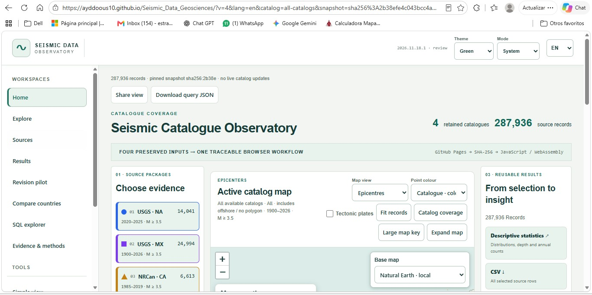
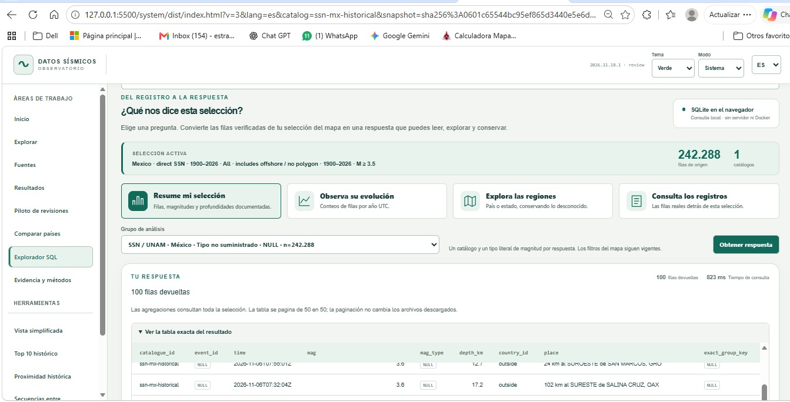
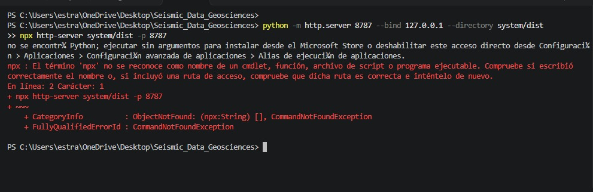

# Montaje del Sistema e Incidencias — Seismic Data Observatory

## 1. Enlaces del proyecto asignado
- **Repositorio original (versión actual del artículo):** https://github.com/gabrielhuav/Seismic_Data_Geosciences/tree/main
- **Fork del equipo:** https://github.com/Ayddoous10/Seismic_Data_Geosciences
- **Versión estática publicada (GitHub Pages):** https://ayddoous10.github.io/Seismic_Data_Geosciences/

## 2. ¿Qué hace el sistema?
**The Seismic Observatory** es una aplicación web estática que se ejecuta completamente en el navegador para explorar catálogos sísmicos históricos preservados, rastrear registros fuente y comparar secuencias sísmicas (familias de sismos y réplicas) entre agencias de Norteamérica.

- **Motor de búsqueda espacial:** Utiliza un árbol KD (*KD-tree*) para buscar eventos "padre" ponderados por magnitud, reduciendo drásticamente el tiempo de cómputo frente a la búsqueda exhaustiva.
- **Espacios de trabajo:** Integra 14 vistas coordinadas (*Home, Explore/Catalogue, Sources, Results/Analysis, Revision pilot, Evidence & methods, SQL explorer, Compare countries, Simple view, Historical Top 10, Historical proximity, Sequences, Article figures* y *Help*) con cartografía local (Natural Earth y placas tectónicas PB2002).
- **Alcance y reglas de evidencia (*Read the Evidence*):**
  - Distingue tres niveles de afirmación: **Instantánea observada** (*Observed snapshot*, calculada sobre la respuesta exacta capturada y verificada por hash), **Proyección retenida** (*Retained projection*, secuencia de versiones retenidas en el archivo) y **Estado pasado del catálogo** (*Past catalog state*, que no se reconstruye de forma completa).
  - Separa el proveedor que distribuye el producto de la institución autora del origen o la magnitud, así como los distintos relojes (*origin time*, *update time*, *index time* y *retrieval time*).
  - **Regla de no fusión:** Los registros de distintos catálogos/proveedores no se fusionan ni se cuentan como eventos independientes; las coincidencias exactas de ID en USGS se marcan por separado sin resolver emparejamientos entre agencias distintas.
  - Es una interfaz de investigación reproducible y **no un servicio operativo de alerta sísmica**.



## 3. Base de datos, esquema y catálogos cargados
A diferencia de la versión del primer parcial (que requería Docker y PostgreSQL), esta versión **no utiliza servidor de base de datos ni contenedores**. Ejecuta **SQLite compilado a WebAssembly (`sql.js 1.13.0`)** dentro de un *Web Worker* en memoria de sesión (solo lectura, con límite de 5,000 filas por consulta).

### Inventario exacto de catálogos (`catalogs.json`)
Total de registros preservados: **287,936 filas** con magnitud reportada $M \ge 3.5$, verificadas mediante **SHA-256**:

| `catalogue_id` | Proveedor | Etiqueta | Periodo UTC | Registros | Unidad de profundidad (`depth_unit`) | Tipo de ID |
|---|---|---|---|---:|---|---|
| `usgs-na-2020-2025` | USGS ComCat | North America · 2020–2025 | 2020–2025 | 14,041 | `km` | Oficial USGS |
| `usgs-mx-historical` | USGS ComCat | Mexico region · paper snapshot | 1900–2026 | 24,994 | `km` | Oficial USGS |
| `nrcan-ca-historical` | NRCan / GSC | Canada and surroundings · 1985–2019 | 1985–2019 | 6,613 | `NULL` (no documentada) | `derived_row_key` |
| `ssn-mx-historical` | SSN / UNAM | Mexico · direct SSN · 1900–2026 | 1900–2026 | 242,288 | `km` | `derived_row_key` |

*(Nota: SSN directo y NRCan no suministran tipo de evento ni `event_id` oficial, por lo que el sistema conserva claves derivadas `derived_row_key` y valores faltantes explícitos en `NULL`).*

### Tablas generadas en memoria (`sql.js`)
1. **`records`:** Una fila por cada registro fuente retenido en la selección activa (`row_no`, `record_key`, `catalogue_id`, `event_id`, `time`, `year`, `latitude`, `longitude`, `mag`, `mag_type`, `depth_km`, `country_id`, `admin1_id`, `provider`, `location_source`, `mag_source`, `place`, `identifier_kind`, `original_fields`, `exact_group_key`, `source_record_count`).
2. **`catalogs`:** Procedencia, cobertura y hashes de cada catálogo seleccionado (`catalogue_id`, `label`, `provider`, `snapshot`, `source_hash`, `manifest_hash`, `identifier_kind`, `depth_unit`).
3. **`exact_membership`:** Miembros de grupos con copias exactas (`group_key`, `representative_key`, `member_key`, `catalogue_id`, `source_event_id`); los grupos unitarios (*singletons*) se omiten.



## 4. Instrucciones de montaje local y publicación
### Despliegue en GitHub Pages
1. Se realizó un *fork* del repositorio oficial en `Ayddoous10/Seismic_Data_Geosciences`.
2. En **Settings → Pages**, se configuró *Source* en **GitHub Actions** (el sitio sirve únicamente la carpeta `system/dist` mediante un workflow manual).
3. En la pestaña **Actions**, se ejecutó manualmente el workflow de despliegue de Pages.

### Montaje en entorno local
1. Clonar el fork:
   ```bash
   git clone https://github.com/Ayddoous10/Seismic_Data_Geosciences.git
   cd Seismic_Data_Geosciences
   ```
2. Servir la carpeta `system/dist` mediante un servidor HTTP local (abrir `index.html` directamente con `file://` falla por políticas CORS al cargar los *Web Workers* y archivos `.json.gz`).

## 5. Incidencia del montaje y cómo se resolvió
- **Qué se intentó:** Siguiendo el `README.md` del repositorio, se intentó levantar el servidor local desde PowerShell en VS Code usando Python y posteriormente Node.js (`npx`):
  ```powershell
  python -m http.server 8787 --bind 127.0.0.1 --directory system/dist
  npx http-server system/dist -p 8787
  ```
- **En qué punto falló:** Al ejecutar el comando del servidor HTTP local inmediatamente después de clonar el repositorio.
- **Mensajes de error obtenidos:**
  - Con Python: `no se encontró Python; ejecutar sin argumentos para instalar desde el Microsoft Store o deshabilitar este acceso directo desde Configuración > Aplicaciones > Configuración avanzada de aplicaciones > Alias de ejecución de aplicaciones.`
  - Con Node.js: `npx : El término 'npx' no se reconoce como nombre de un cmdlet, función, archivo de script o programa ejecutable.`
- **Cómo se resolvió:** Se instaló la extensión **Live Server** en Visual Studio Code, se abrió la carpeta del repositorio y se ejecutó **Open with Live Server** directamente sobre `system/dist/index.html`. Esto levantó el servidor HTTP local en `127.0.0.1`, cargando correctamente los 4 catálogos (287,936 filas) y el entorno `sql.js`. No quedaron pasos pendientes.

