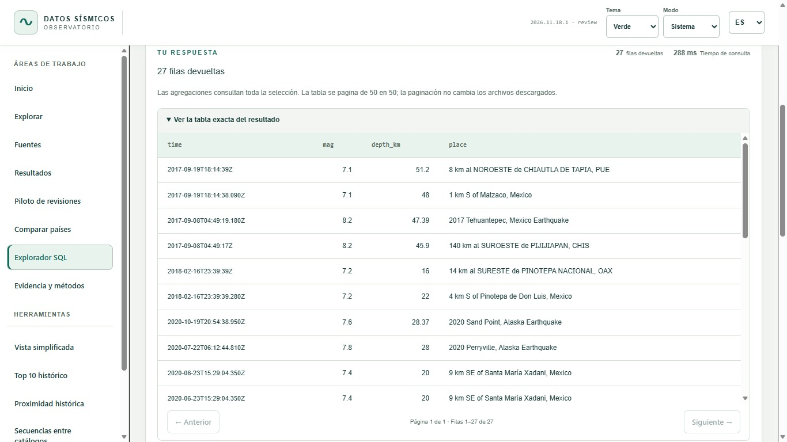
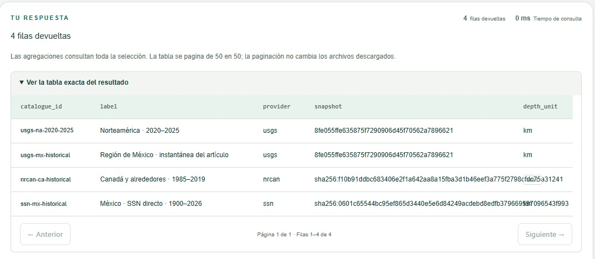
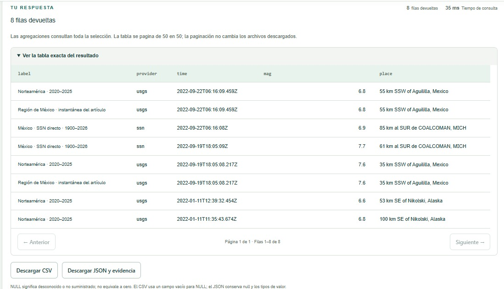

# Consultas en Álgebra Relacional, SQL (SQLite) y RelaX

Todas las consultas se ejecutaron sobre el esquema en memoria de `sql.js` (`records` y `catalogs`) en **SQL explorer → Advanced SQL editor** y se validaron lógicamente en **RelaX** mediante una muestra controlada ([`relax-sismos.txt`](relax-sismos.txt)) que utiliza los `catalogue_id` reales de `catalogs.json` e incluye tanto registros que cumplen las condiciones como registros de control que deben ser descartados.

---

## Consulta 1 — Selección ($\sigma$)

- **Pregunta:** ¿Cuáles son los sismos de gran magnitud ($M \ge 7.0$) registrados a partir del año 2017, mostrando su fecha UTC, magnitud, profundidad en kilómetros y ubicación?
- **Expresión en Álgebra Relacional:**
  $$\pi_{\text{time}, \text{mag}, \text{depth\_km}, \text{place}}\Big(\sigma_{\text{mag} \ge 7.0 \land \text{year} \ge 2017}(\text{records})\Big)$$
- **Operador principal:** Selección ($\sigma$).
- **Árbol de operadores:**
  ```text
        π (time, mag, depth_km, place)
                      |
        σ (mag >= 7.0 ∧ year >= 2017)
                      |
                   records
  ```
- **SQL equivalente (SQLite / `sql.js`):**
  ```sql
  SELECT time, mag, depth_km, place
  FROM records
  WHERE mag >= 7.0 AND year >= 2017;
  ```
- **Correspondencia SQL ↔ Álgebra Relacional:**
  - `FROM records` corresponde a la relación base `records`.
  - `WHERE mag >= 7.0 AND year >= 2017` corresponde al operador de selección $\sigma$.
  - `SELECT time, mag, depth_km, place` corresponde al operador de proyección $\pi$.
- **Resultados obtenidos en SQLite:**

| time | mag | depth_km | place |
|---|---|---|---|
| `2017-09-19T18:14:39Z` | 7.1 | 51.2 | 8 km al NOROESTE de CHIAUTLA DE TAPIA, PUE |
| `2017-09-08T04:49:17Z` | 8.2 | 45.9 | 140 km al SUROESTE de PIJIJIAPAN, CHIS |
| `2018-02-16T23:39:39Z` | 7.2 | 16.0 | 14 km al SURESTE de PINOTEPA NACIONAL, OAX |
| `2020-06-23T15:29:03Z` | 7.4 | 22.8 | 4 km al NORTE de CRUCECITA, OAX |
| `2021-09-08T01:47:46Z` | 7.1 | 15.0 | 14 km al SUROESTE de ACAPULCO, GRO |
| `2022-09-19T18:05:09Z` | 7.7 | 12.1 | 61 km al SUR de COALCOMAN, MICH |
| `2026-07-17T14:48:38Z` | 7.4 | 10.0 | 135 km al SUROESTE de CD HIDALGO, CHIS |

- **Expresión en RelaX:**
  ```text
  pi time, mag, depth_km, place (sigma mag >= 7.0 and year >= 2017 (records))
  ```




---

## Consulta 2 — Proyección ($\pi$)

- **Pregunta:** ¿Qué catálogos fuente están cargados en el observatorio, mostrando su identificador, nombre descriptivo, proveedor, versión (`snapshot`) y unidad de profundidad documentada?
- **Expresión en Álgebra Relacional:**
  $$\pi_{\text{catalogue\_id}, \text{label}, \text{provider}, \text{snapshot}, \text{depth\_unit}}(\text{catalogs})$$
- **Operador principal:** Proyección ($\pi$).
- **Árbol de operadores:**
  ```text
  π (catalogue_id, label, provider, snapshot, depth_unit)
                            |
                        catalogs
  ```
- **SQL equivalente (SQLite / `sql.js`):**
  ```sql
  SELECT catalogue_id, label, provider, snapshot, depth_unit
  FROM catalogs;
  ```
- **Correspondencia SQL ↔ Álgebra Relacional:**
  - `FROM catalogs` corresponde a la relación base `catalogs`.
  - `SELECT catalogue_id, label, provider, snapshot, depth_unit` corresponde a la proyección $\pi$ que extrae únicamente los 5 atributos solicitados de los 4 catálogos cargados.
- **Resultados obtenidos en SQLite (correspondientes a `catalogs.json`):**

| catalogue_id | label | provider | snapshot | depth_unit |
|---|---|---|---|---|
| `usgs-na-2020-2025` | North America · 2020–2025 | `usgs` | `8fe055ffe635875f7290906d45f70562a7896621` | `km` |
| `usgs-mx-historical` | Mexico region · paper snapshot | `usgs` | `8fe055ffe635875f7290906d45f70562a7896621` | `km` |
| `nrcan-ca-historical` | Canada and surroundings · 1985–2019 | `nrcan` | `sha256:f10b91ddbc683406e2f1a642aa8a15fba3d1b46eef3a775f2798cfdc75a31241` | `NULL` |
| `ssn-mx-historical` | Mexico · direct SSN · 1900–2026 | `ssn` | `sha256:0601c65544bc95ef865d3440e5e6d84249acdebd8edfb379669597096543f993` | `km` |

- **Expresión en RelaX:**
  ```text
  pi catalogue_id, label, provider, snapshot, depth_unit (catalogs)
  ```




---

## Consulta 3 — Reunión ($\bowtie$)

- **Pregunta:** ¿Qué sismos con magnitud mayor o igual a 6.5 ocurrieron en el año 2022, mostrando el nombre oficial del catálogo (`label`), su proveedor (`provider`), la fecha (`time`), la magnitud (`mag`) y el lugar (`place`)?
- **Expresión en Álgebra Relacional:**
  $$\pi_{\text{c.label}, \text{c.provider}, \text{r.time}, \text{r.mag}, \text{r.place}}\Big(\sigma_{\text{r.mag} \ge 6.5 \land \text{r.year} = 2022}\big(\rho_{r}(\text{records}) \bowtie_{\text{r.catalogue\_id} = \text{c.catalogue\_id}} \rho_{c}(\text{catalogs})\big)\Big)$$
- **Operador principal:** Reunión ($\bowtie$).
- **Árbol de operadores:**
  ```text
        π (c.label, c.provider, r.time, r.mag, r.place)
                               |
                σ (r.mag >= 6.5 ∧ r.year = 2022)
                               |
                ⋈ (r.catalogue_id = c.catalogue_id)
                      /                 \
               ρ r (records)      ρ c (catalogs)
  ```
- **SQL equivalente (SQLite / `sql.js`):**
  ```sql
  SELECT c.label, c.provider, r.time, r.mag, r.place
  FROM records AS r
  JOIN catalogs AS c ON r.catalogue_id = c.catalogue_id
  WHERE r.mag >= 6.5 AND r.year = 2022;
  ```
- **Correspondencia SQL ↔ Álgebra Relacional:**
  - `records AS r` y `catalogs AS c` corresponden a los renombramientos $\rho_r$ y $\rho_c$.
  - `JOIN ... ON r.catalogue_id = c.catalogue_id` corresponde a la reunión $\bowtie$ que asocia cada sismo con la procedencia de su catálogo.
  - `WHERE r.mag >= 6.5 AND r.year = 2022` corresponde a la selección $\sigma$.
  - `SELECT ...` corresponde a la proyección $\pi$ de atributos de ambas tablas.
- **Resultados obtenidos en SQLite:**
  | label | provider | time | mag | place |
|---|---|---|---|---|
| Norteamérica · 2020–2025 | usgs | `2022-09-22T06:16:09.459Z` | 6.8 | 55 km SSW of Aguililla, Mexico |
| Región de México · instantánea del artículo | usgs | `2022-09-22T06:16:09.459Z` | 6.8 | 55 km SSW of Aguililla, Mexico |
| México · SSN directo · 1900–2026 | ssn | `2022-09-22T06:16:08Z` | 6.9 | 85 km al SUR de COALCOMAN, MICH |
| México · SSN directo · 1900–2026 | ssn | `2022-09-19T18:05:09Z` | 7.7 | 61 km al SUR de COALCOMAN, MICH |
| Norteamérica · 2020–2025 | usgs | `2022-09-19T18:05:08.217Z` | 7.6 | 35 km SSW of Aguililla, Mexico |
| Región de México · instantánea del artículo | usgs | `2022-09-19T18:05:08.217Z` | 7.6 | 35 km SSW of Aguililla, Mexico |
| Norteamérica · 2020–2025 | usgs | `2022-01-11T12:39:32.454Z` | 6.6 | 53 km SE of Nikolski, Alaska |
| Norteamérica · 2020–2025 | usgs | `2022-01-11T11:35:43.674Z` | 6.8 | 100 km SE of Nikolski, Alaska |
- **Expresión en RelaX:**
  ```text
  pi c.label, c.provider, r.time, r.mag, r.place (
    sigma r.mag >= 6.5 and r.year = 2022 (
      (rho r (records)) join r.catalogue_id = c.catalogue_id (rho c (catalogs))
    )
  )
  ```


