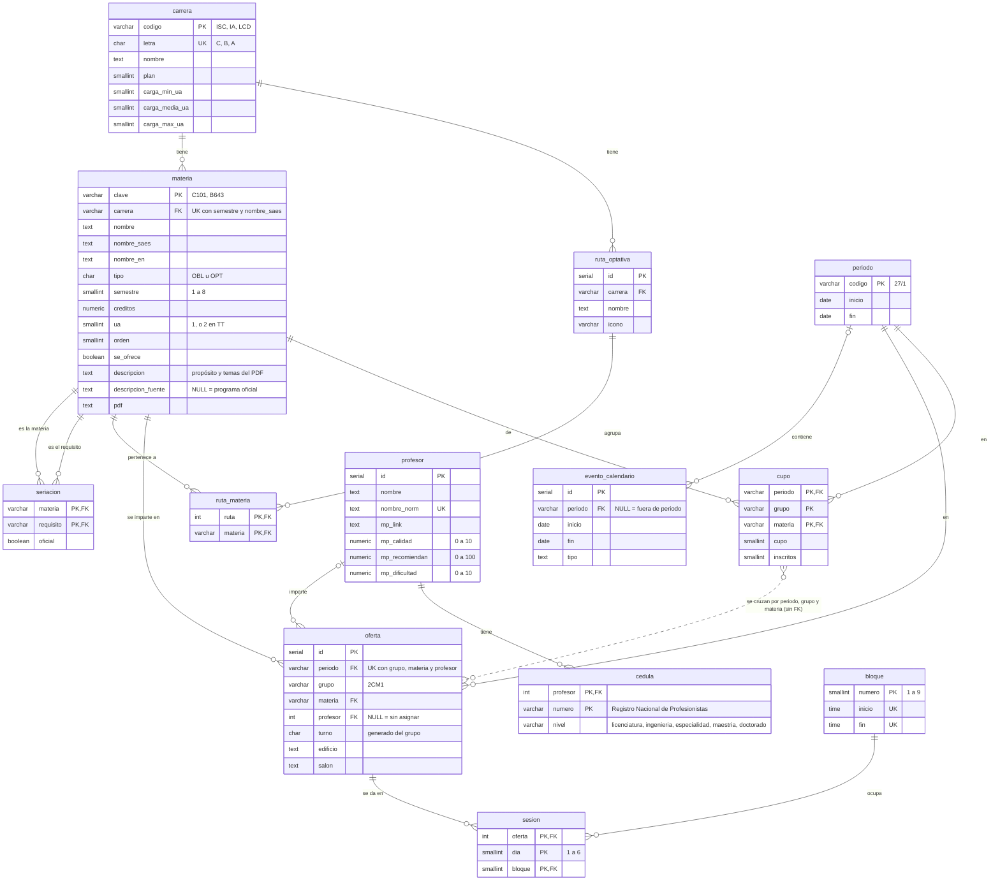
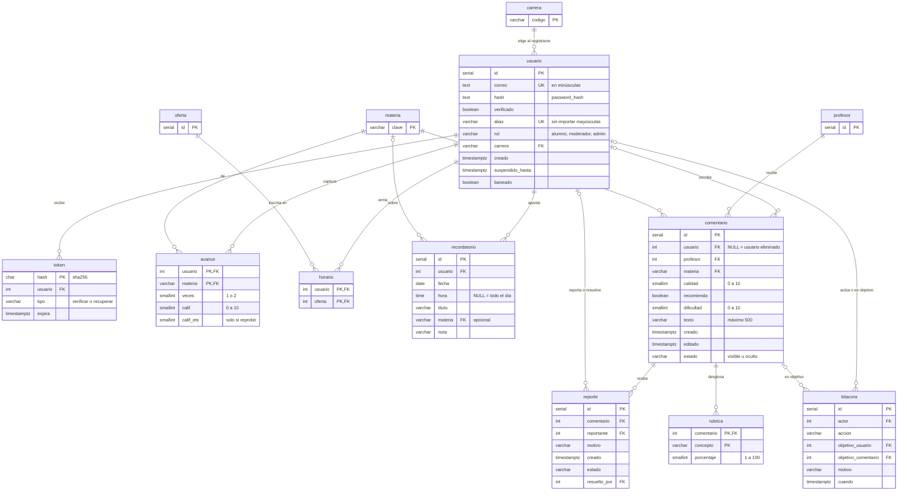

# Modelo relacional de Gestorix

Sale de [`sql/00-tablas.sql`](https://github.com/pablo140706/Gestorix/blob/main/sql/00-tablas.sql), que es el que manda. GitHub dibuja los
diagramas solo (Mermaid). Están en dos partes para que se lean: el **catálogo** (lo que viene de
SAES y del IPN) y lo de los **usuarios** (cuentas, avance, comentarios y moderación). La tabla
`usuario` sale en las dos partes porque las une.

Notación: `||` = exactamente uno, `|o` = cero o uno (llave foránea que acepta `NULL`),
`o{` = cero o muchos. PK = llave primaria, FK = llave foránea, UK = única.

## 1. Catálogo: plan de estudios, profesores y horarios

## 2. Usuarios: cuentas, avance, horario, agenda y comentarios

## 3. Qué pasa al borrar (acciones referenciales)

| Llave foránea | Al borrar el padre | Por qué |
|---|---|---|
| `sesion.oferta` | `CASCADE` | Una sesión no existe sin su clase |
| `cedula.profesor` | `CASCADE` | Las cédulas son parte del profesor |
| `token`, `avance`, `horario`, `recordatorio` → `usuario` | `CASCADE` | Son datos personales: se van con la cuenta |
| `rubrica.comentario`, `reporte.comentario` | `CASCADE` | Son parte del comentario |
| `comentario.usuario` | `SET NULL` | El comentario se queda como "usuario eliminado" (decisión del usuario) |
| `reporte.reportante`, `reporte.resuelto_por`, `bitacora.*` | `SET NULL` | La bitácora de moderación no se pierde si alguien borra su cuenta |
| Todo lo del catálogo (`materia`, `profesor`, `oferta`, `periodo`…) | `NO ACTION` (rechaza) | pgAdmin no deja borrar una materia o un profesor que se está usando |

## 4. Restricciones de dominio que vale la pena enseñar

| Tabla | Restricción | Qué atrapa |
|---|---|---|
| `oferta`, `cupo` | `grupo ~ '^[1-8][ABC][MVX][1-9][0-9]?$'` | Un grupo mal escrito (`2XM1`); acepta `1CM10` |
| `profesor` | `mp_calidad` y `mp_dificultad BETWEEN 0 AND 10` | Errores reales de captura en las métricas de iscweb: OLALDE 83 en calidad, LUNA BENOSO 44 y MÁRQUEZ ARREGUÍN 33 en dificultad (eran 8.3, 4.4 y 3.3) |
| `avance` | `veces IN (1, 2)` y `calif_ets IS NULL OR calif < 6` | Una 3.ª vez cursada, o un ETS de una materia aprobada |
| `usuario` | `correo = lower(correo)` e índice único sobre `lower(alias)` | Dos cuentas con el mismo correo en mayúsculas, o "Pablo" y "pablo" |
| `oferta` | `UNIQUE NULLS NOT DISTINCT (periodo, grupo, materia, profesor)` | Dos ofertas "sin profesor" iguales |
| `carrera` | `carga_min_ua <= carga_media_ua <= carga_max_ua` | Una carga académica imposible |
| `seriacion` | `materia <> requisito` | Una materia que se pide a sí misma |
| `cedula` | `numero ~ '^[0-9]{5,9}$'` y `nivel IN (…)` | Una cédula capturada con letras (`L2890498`) o un texto como `no-existe` |

La vista `avance_status` deriva el status (pendiente, en recurse, aprobada, reprobada, solo por
ETS, aprobada por ETS) y la calificación final de `veces`, `calif` y `calif_ets`, así que esos
datos no se guardan dos veces.
